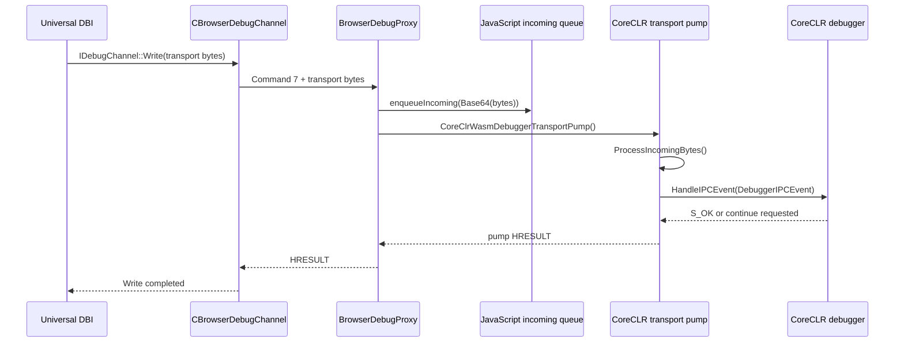
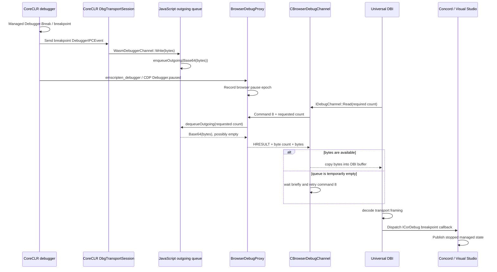
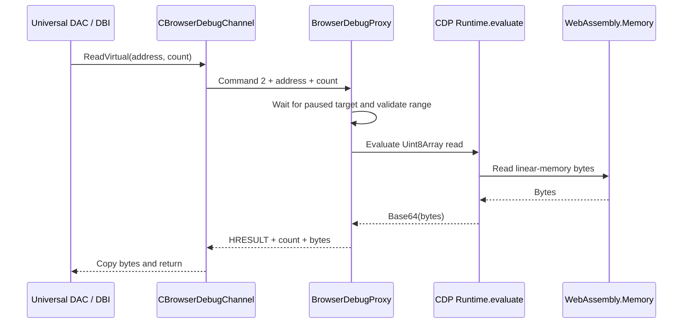
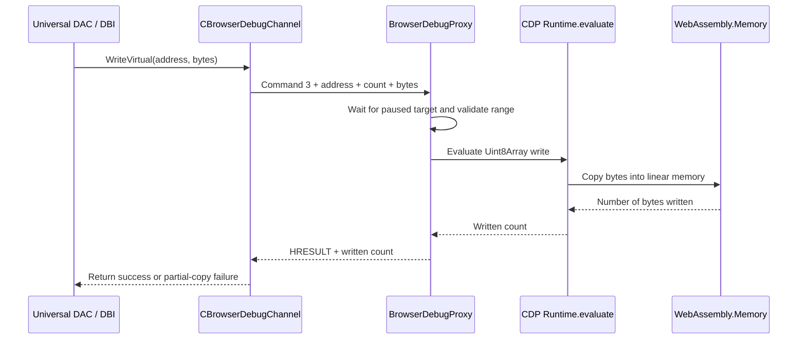

# Browser CoreCLR debugging with universal DAC and DBI

This document describes the prototype architecture used to debug CoreCLR running
as WebAssembly in a browser. It covers:

- loading the universal DAC and DBI;
- connecting Concord to BrowserDebugProxy;
- reading and writing WebAssembly linear memory;
- transporting CoreCLR debugger IPC messages in both directions;
- coordinating browser pauses, managed debugger events, continue requests, and
  function evaluation.

The implementation spans three repositories:

- **dotnet/runtime**
  - universal DAC and DBI;
  - the CoreCLR left-side debugger;
  - the cooperative WebAssembly debugger transport;
  - the JavaScript byte queues exposed by the browser runtime.
- **dotnet-diagnostics-internal-components**
  - `Microsoft.Diagnostics.BrowserDebugProxy`;
  - the bridge between the local Concord connection and Chrome DevTools
    Protocol (CDP).
- **Concord**
  - the browser debug channel;
  - universal DAC/DBI loading;
  - the `ICorDebug` wrapper used by the Visual Studio debug engine.

## Architecture

There are two nested protocols:

1. The **browser debug channel protocol** is a small request/response protocol
   between Concord and BrowserDebugProxy. It carries target information, memory
   operations, process control, and opaque debugger transport bytes.
2. The **CoreCLR debugger transport protocol** is the existing DBI-to-runtime
   protocol implemented by `DbgTransportSession`. Its framed messages and
   `DebuggerIPCEvent` payloads are carried unchanged inside browser debug channel
   commands 7 and 8.

Keeping these protocols separate is important. BrowserDebugProxy understands
browser pause state and WebAssembly memory, but it does not decode the CoreCLR
debugger transport. DBI and the runtime continue to own that protocol.

Visual Studio communicates with universal DBI through `ICorDebug`. Universal
DBI uses `CBrowserDebugChannel` for both target-memory access and its
byte-oriented `IDebugChannel`. Concord sends browser-channel requests over
localhost TCP to BrowserDebugProxy. The proxy uses CDP to evaluate JavaScript,
access WebAssembly linear memory, and control physical browser pauses.

Commands 7 and 8 do not define new debugger events. They carry portions of the
existing `DbgTransportSession` byte stream inside the browser debug channel.
BrowserDebugProxy treats those bytes as opaque.

## Starting the browser connection

For a browser CoreCLR target, Concord takes a browser-specific branch in
`CDbgShimLiveProcLoader`.

1. Concord creates `CBrowserDebugChannel`.
2. The channel opens a localhost TCP listener on the configured ICorDebug port.
3. BrowserDebugProxy starts `CoreClrProxy.RunDebugChannelAsync` and connects to
   that listener.
4. Concord waits for the connection and sends `GetTargetInfo`.
5. BrowserDebugProxy waits until:
   - the CoreCLR browser runtime has begun initialization;
   - WebAssembly linear memory is available;
   - the address of `DotNetRuntimeContractDescriptor` is available; and
   - the browser target is paused.
6. BrowserDebugProxy returns the runtime identity and contract information that
   Concord needs to create the virtual process.

The current browser target information contains:

| Field | Current value or source |
|---|---|
| Runtime base address | Nonzero virtual-process identity |
| CLR instance ID | Nonzero virtual-process identity |
| Contract descriptor address | Address exported by the CoreCLR browser runtime |
| Pointer size | 4 bytes |
| Platform | Browser/WASM `CorDebugPlatform` value |

The runtime base and CLR instance ID identify the single browser runtime. Target
memory access is based on WebAssembly linear-memory offsets rather than an
operating-system process address space.

## Loading the universal DBI and DAC

After receiving valid target information, Concord resolves both universal
components from its browser assets directory:

```text
mscordbi_universal.dll
mscordaccore_universal.dll
```

Concord loads `mscordbi_universal.dll` and resolves:

- `OpenVirtualProcessImpl4`;
- `RegisterVirtualProcessImpl`.

It calls `OpenVirtualProcessImpl4` with:

- the browser CLR instance ID;
- `CBrowserDebugChannel` as an `ICorDebugMutableDataTarget`;
- the path to `mscordaccore_universal.dll`;
- the target contract descriptor address;
- the requested `ICorDebugProcess` interface.

`OpenVirtualProcessImpl4` performs two related operations:

1. It creates an `ICorDebug`/`Cordb` instance in universal DBI.
2. It loads the specified universal DAC and creates a virtual
   `ICorDebugProcess` backed by the supplied data target.

Universal DBI passes the data target and contract descriptor address to the
universal DAC. The universal DAC export `DacDbiInterfaceInstance` converts the
COM `ICorDebugDataTarget` into a managed data target and creates a
`ContractDescriptorTarget`.

DBI and DAC data requests flow through `ICorDebugDataTarget` or
`ICorDebugMutableDataTarget`, `CBrowserDebugChannel`, BrowserDebugProxy, and
finally WebAssembly linear memory.

The explicit contract descriptor address is necessary because the browser data
target is virtual and does not discover the descriptor through normal native
module or process APIs.

### Registering the virtual process

Concord wraps the returned `ICorDebug` in `CBrowserCorDebug`.

When Visual Studio calls `DebugActiveProcess`, the wrapper calls
`RegisterVirtualProcessImpl` once. This registers the virtual
`ICorDebugProcess` with the `Cordb` instance returned by
`OpenVirtualProcessImpl4`.

The browser was already running before DBI attached, so there are no natural
startup callbacks for the existing state. Concord synthesizes the initial
callback sequence by enumerating the virtual process and replaying:

- `CreateProcess`;
- `CreateAppDomain`;
- `LoadAssembly`;
- `LoadModule`;
- `CreateThread`.

Continue requests issued while this initial callback sequence is being replayed
are deferred until replay finishes.

## Browser debug channel protocol

The Concord-to-proxy connection is a serialized request/response protocol over
localhost TCP.

All integer fields are little-endian. Every message starts with a 16-byte
header:

| Offset | Size | Field |
|---:|---:|---|
| 0 | 4 | Magic: `0x43444257` |
| 4 | 2 | Protocol version: `1` |
| 6 | 2 | Command |
| 8 | 4 | Request ID |
| 12 | 4 | Payload size |

A response uses the same command with bit `0x8000` set. Payloads are limited to
64 MiB. Concord serializes requests with a critical section because the
connection carries synchronous request/response pairs.

### Commands

| ID | Command | Purpose |
|---:|---|---|
| 1 | `GetTargetInfo` | Returns runtime identity, contract descriptor, pointer size, and platform |
| 2 | `ReadMemory` | Reads a range from WebAssembly linear memory |
| 3 | `WriteMemory` | Writes a range to WebAssembly linear memory |
| 4 | `ContinueProcess` | Resumes the currently recorded browser pause |
| 5 | `StopProcess` | Requests a CDP `Debugger.pause` |
| 6 | `GetPauseState` | Returns the current browser pause epoch, or zero when running |
| 7 | `WriteDebuggerTransport` | Sends opaque DBI transport bytes to CoreCLR |
| 8 | `ReadDebuggerTransport` | Receives opaque DBI transport bytes from CoreCLR |
| 9 | `FuncEvalResultConsumed` | Releases a function-evaluation completion pause and waits for restoration of the original managed pause |

Most responses begin with a 32-bit `HRESULT`. Memory and control responses also
contain counts or pause epochs as appropriate.

### Commands 7 and 8

The command names are from Concord's point of view:

- **Command 7, `WriteDebuggerTransport`, writes bytes from DBI to CoreCLR.**
- **Command 8, `ReadDebuggerTransport`, reads bytes produced by CoreCLR for
  DBI.**

They form the full-duplex `IDebugChannel` used by `DbgTransportSession`.

#### Sending an IPC event from the debugger to CoreCLR



The command 7 payload is exactly the byte array passed to
`CBrowserDebugChannel::Write`. BrowserDebugProxy does not parse its transport
headers or IPC event. It Base64-encodes the bytes only to place them in the page
through `Runtime.evaluate`.

After enqueueing the bytes, BrowserDebugProxy immediately invokes the runtime
pump. The runtime's `DbgTransportSession` can then assemble complete messages
and deliver the contained event to `Debugger::HandleIPCEvent`.

If event handling continues the runtime, the pump returns `S_FALSE`.
BrowserDebugProxy uses that return value to resume the corresponding physical
CDP pause.

Command 7 does not pass a `DebuggerIPCEvent` directly to the debugger. It may
deliver any fragment of the transport byte stream. The runtime performs framing,
unmarshalling, queueing, and dispatch inside CoreCLR. `ProcessIncomingBytes`
accumulates partial messages. Complete `MT_Event` messages are unmarshalled by
`QueueEvent` into a locked circular event buffer. The WASM pump calls
`HasPendingEvent`, removes each event with `GetNextEvent`, and passes it to
`HandleIPCEventWrapper`.

If the dequeued event is a `DB_IPCE_CONTINUE` received while the runtime is
already running, the pump resets the debugger's running state and returns
`S_FALSE`. Otherwise it acquires the debugger lock when required and processes
the event normally. Returning `S_FALSE` tells BrowserDebugProxy that the
physical browser pause must also be resumed.

#### Receiving an IPC event after a user break



The command 8 request payload is a 32-bit requested byte count:

| Offset | Size | Field |
|---:|---:|---|
| 0 | 4 | Maximum bytes requested |

Its response is:

| Offset | Size | Field |
|---:|---:|---|
| 0 | 4 | `HRESULT` |
| 4 | 4 | Bytes returned |
| 8 | N | Opaque CoreCLR debugger transport bytes |

An empty successful response means that CoreCLR has not produced more bytes
yet. It is not end-of-stream. Concord waits briefly and sends another command 8
until it has filled the exact read requested by DBI.

The outgoing queue can contain part of one transport message, exactly one
message, or bytes from multiple messages. Message boundaries are reconstructed
only by DBI's `DbgTransportSession`.

## Reading target memory

The universal DAC and DBI call `CBrowserDebugChannel::ReadVirtual` through
`ICorDebugDataTarget`.



The request payload is:

| Offset | Size | Field |
|---:|---:|---|
| 0 | 8 | Target address |
| 8 | 4 | Requested byte count |

BrowserDebugProxy:

1. waits for the target to be paused;
2. validates that the requested range is within the current WebAssembly memory;
3. refreshes the memory length if memory may have grown;
4. evaluates JavaScript in the page to create a `Uint8Array` over the requested
   range;
5. converts the bytes to Base64 for transport through CDP;
6. decodes the result in BrowserDebugProxy and returns the raw bytes to
   Concord.

The response contains:

| Offset | Size | Field |
|---:|---:|---|
| 0 | 4 | `HRESULT` |
| 4 | 4 | Bytes read |
| 8 | N | Data |

Concord requires a complete read. A short result is reported as
`ERROR_PARTIAL_COPY`.

The memory address is a WebAssembly linear-memory offset. BrowserDebugProxy uses
the runtime's active `WebAssembly.Memory` object, not an operating-system
`ReadProcessMemory` operation.

## Writing target memory

The universal DAC and DBI call `CBrowserDebugChannel::WriteVirtual` through
`ICorDebugMutableDataTarget`.



The request payload is:

| Offset | Size | Field |
|---:|---:|---|
| 0 | 8 | Target address |
| 8 | 4 | Byte count |
| 12 | N | Data |

BrowserDebugProxy validates the range, Base64-encodes the bytes for a CDP
evaluation, and runs JavaScript that copies them into a `Uint8Array` over
WebAssembly linear memory.

The response contains an `HRESULT` and the number of bytes written. Concord
requires the returned count to equal the requested count.

Memory operations are serialized in BrowserDebugProxy by a memory gate. They are
performed only while the target is paused so that DAC and DBI observe a stable
managed process state.

## CoreCLR debugger transport in the browser

The regular CoreCLR debugger protocol assumes a byte-oriented `IDebugChannel`.
The browser implementation preserves that abstraction on both sides:

- **DBI side:** `CBrowserDebugChannel` implements `IDebugChannel`.
- **Runtime side:** `WasmDebuggerChannel` implements `IDebugChannel`.

Each side owns a `DbgTransportSession`. The browser channel and JavaScript queues
replace the operating-system socket or pipe normally used between them.

### JavaScript transport queues

The runtime loader creates:

```js
globalThis.__coreclrWasmDebuggerTransport
```

It contains two byte queues:

- **incoming:** DBI to CoreCLR;
- **outgoing:** CoreCLR to DBI.

The object exposes:

- `enqueueIncoming`;
- `dequeueIncoming`;
- `incomingByteCount`;
- `enqueueOutgoing`;
- `dequeueOutgoing`;
- `outgoingByteCount`;
- `pump`.

Queue API payloads are Base64 strings because CDP evaluations return
JavaScript-compatible values. The bytes inside the queues remain the original
opaque debugger transport stream.

`pump` calls the exported WebAssembly function
`CoreClrWasmDebuggerTransportPump`.

## Sending IPC from DBI to CoreCLR

Detailed flow:

1. Universal DBI serializes a normal debugger transport message.
2. DBI writes the bytes through `IDebugChannel::Write`.
3. Concord sends command 7 with those bytes as its payload.
4. BrowserDebugProxy Base64-encodes the payload and evaluates JavaScript that
   appends it to the incoming queue.
5. BrowserDebugProxy invokes `pump`.
6. `CoreClrWasmDebuggerTransportPump` removes available bytes from the incoming
   queue and passes them to `DbgTransportSession::ProcessIncomingBytes`.
7. `DbgTransportSession` performs its normal framing and queues complete
   debugger events.
8. The pump dequeues pending events and calls the normal CoreCLR
   `HandleIPCEvent` path.

The browser is single-threaded, so this processing is cooperative rather than
being performed by a dedicated debugger transport thread. When the pump
re-enters CoreCLR on a managed thread, it temporarily enters cooperative GC mode
before handling the debugger event.

If handling an event continues the runtime, the pump returns `S_FALSE`.
BrowserDebugProxy uses that result to coordinate the corresponding CDP
`Debugger.resume`.

## Sending IPC from CoreCLR to DBI

Detailed flow:

1. CoreCLR fills the single-threaded `DebuggerIPCEvent` buffer.
2. `SendSingleThreadedDebuggerIPCEvent` sends it through the runtime
   `DbgTransportSession`.
3. `WasmDebuggerChannel::Write` copies the serialized transport bytes to the
   JavaScript outgoing queue.
4. Universal DBI eventually calls `CBrowserDebugChannel::Read` for an exact
   number of bytes.
5. Concord sends command 8 with the requested byte count.
6. BrowserDebugProxy evaluates JavaScript that removes up to that count from the
   outgoing queue.
7. BrowserDebugProxy returns the bytes to Concord.
8. Concord continues polling when zero bytes are currently available and
   returns only after satisfying DBI's requested read size.
9. Universal DBI decodes the normal transport framing and dispatches the
   corresponding `ICorDebugManagedCallback`.

`DB_IPCE_SYNC_COMPLETE` uses the old-style event path. Other debugger events are
sent as debug events, matching the existing `DbgTransportSession` distinction.

## Browser pauses and managed debugger events

A browser pause and a managed debugger stop are related but not identical:

- CDP owns whether JavaScript/WebAssembly execution is physically paused.
- CoreCLR and DBI own managed debugger state and `DebuggerIPCEvent` delivery.
- BrowserDebugProxy records the relationship between the two.

BrowserDebugProxy assigns a monotonically increasing **pause epoch** to every
accepted `Debugger.paused` event. Concord can query the current epoch with
`GetPauseState`.

The epoch prevents a continue intended for one stop from accidentally resuming
a later stop.

### Managed breakpoint flow

A typical managed breakpoint or `Debugger.Break` flow is:

1. CoreCLR creates and sends the managed breakpoint IPC event.
2. CoreCLR enters `emscripten_debugger()`, causing CDP to report
   `Debugger.paused`.
3. BrowserDebugProxy records the browser session and increments the pause epoch.
4. Universal DBI reads the event through command 8.
5. DBI dispatches the managed callback through Concord.
6. Visual Studio displays the stopped managed state.
7. When the debugger continues, Concord first records whether a physical
   browser pause exists.
8. After DBI completes its continue transition, Concord sends command 4.
9. BrowserDebugProxy sends CDP `Debugger.resume` for the recorded pause epoch.

The managed event is the authoritative source of the managed callback.
Concord does not synthesize a second user-break callback merely because CDP
reported a browser pause.

### Explicit stop

For an explicit debugger stop, command 5 increments a nested stop count and
requests CDP `Debugger.pause` if the browser is not already paused. Once the
pause is observed, Concord dispatches the corresponding browser async-break
callback.

Nested stop/continue operations retain the physical pause until the stop count
returns to zero.

## Function evaluation

Function evaluation requires additional pause coordination because a single
evaluation temporarily changes the meaning of the browser pause.

The implemented sequence is:

1. The original managed stop leaves CoreCLR with a saved managed context.
2. DBI sends the function-evaluation setup IPC request.
3. CoreCLR queues the evaluation and installs the saved context while processing
   pending evaluations.
4. Concord continues the process.
5. BrowserDebugProxy resumes the original CDP pause so managed evaluation code
   can run.
6. CoreCLR executes the evaluation and sends `DB_IPCE_FUNC_EVAL_COMPLETE`.
7. CoreCLR pauses in the browser again.
8. DBI receives the completion event and VIL retrieves the result.
9. `CordbEval::GetResult` notifies the private process-control interface that
   the result was consumed.
10. Concord sends command 9, `FuncEvalResultConsumed`.
11. BrowserDebugProxy resumes the function-evaluation completion pause.
12. Before the saved managed context holder is destroyed, CoreCLR creates a new
    runtime-owned browser pause.
13. BrowserDebugProxy waits for this later pause epoch before completing command
    9.

The final pause restores the original managed inspection state at a known safe
point. BrowserDebugProxy must not replace this with an arbitrary
`Debugger.pause`, because an arbitrary instruction may be unsafe for the next
function-evaluation setup.

## Process-control interface

`CBrowserDebugChannel` also implements a private `ICorDebugProcessControl`
interface used by universal DBI:

- `ContinueProcess`;
- `ContinueCompleted`;
- `StopProcess`;
- `FuncEvalResultConsumed`.

This interface connects DBI state transitions to physical browser pause
transitions without making BrowserDebugProxy understand DBI internals.

## Current platform assumptions and limitations

- The target is currently WASM32, with a four-byte target pointer size.
- WebAssembly addresses are represented as 64-bit protocol fields but must
  resolve to valid offsets in the current linear memory.
- Memory may grow, so BrowserDebugProxy refreshes the memory length when a range
  falls outside the cached size.
- `GetThreadContext`, `SetThreadContext`, and `ContinueStatusChanged` are not
  implemented by the browser data target. The debugger uses interpreter-managed
  contexts for the supported paths.
- The browser runtime has no normal debugger helper thread. IPC handling is
  cooperatively pumped on the browser thread.
- The localhost browser debug channel currently has one in-flight serialized
  request at a time.
- Empty debugger transport reads are normal. Concord waits briefly and retries
  until it has returned the exact number of bytes requested by DBI.
- DAC and DBI binaries must match the contract and interfaces expected by the
  runtime and Concord deployment.

## Main implementation files

### dotnet/runtime

- `src/coreclr/debug/di/process.cpp`
  - `OpenVirtualProcessImpl4`;
  - `RegisterVirtualProcessImpl`;
  - browser process-control integration.
- `src/coreclr/debug/shared/dbgtransportsession.cpp`
  - CoreCLR debugger transport framing and event queues.
- `src/coreclr/debug/ee/wks/wasm/wasmdebugger.cpp`
  - runtime `IDebugChannel`;
  - cooperative transport pump;
  - browser pause support.
- `src/native/libs/Common/JavaScript/loader/run.ts`
  - `globalThis.__coreclrWasmDebuggerTransport`;
  - incoming and outgoing JavaScript byte queues.
- `src/native/managed/cdac/mscordaccore_universal/Entrypoints.cs`
  - universal DAC exports;
  - creation of `ContractDescriptorTarget` from
    `ICorDebugDataTarget`.

### dotnet-diagnostics-internal-components

- `src/WasmDebugger/Microsoft.Diagnostics.BrowserDebugProxy/CoreClrProxy.cs`
  - browser debug channel server peer;
  - CDP pause/resume coordination;
  - memory access;
  - debugger transport queue bridge.

### Concord

- `src/impl/ManagedDM/V2/DbgShimLiveProcLoader.cpp`
  - browser attach branch;
  - universal DAC/DBI loading;
  - virtual-process creation.
- `src/impl/ManagedDM/V2/BrowserDebugChannel.h`
  - browser protocol definitions;
  - `IDebugChannel`, data-target, and process-control interfaces.
- `src/impl/ManagedDM/V2/BrowserDebugChannel.cpp`
  - protocol implementation;
  - memory and debugger transport operations;
  - `CBrowserCorDebug` and initial callback replay.
